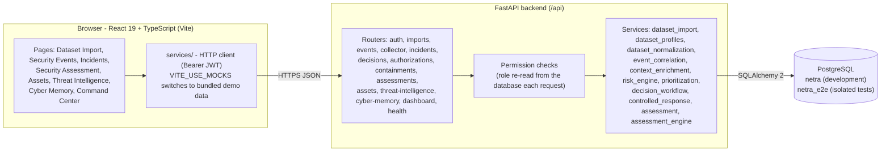
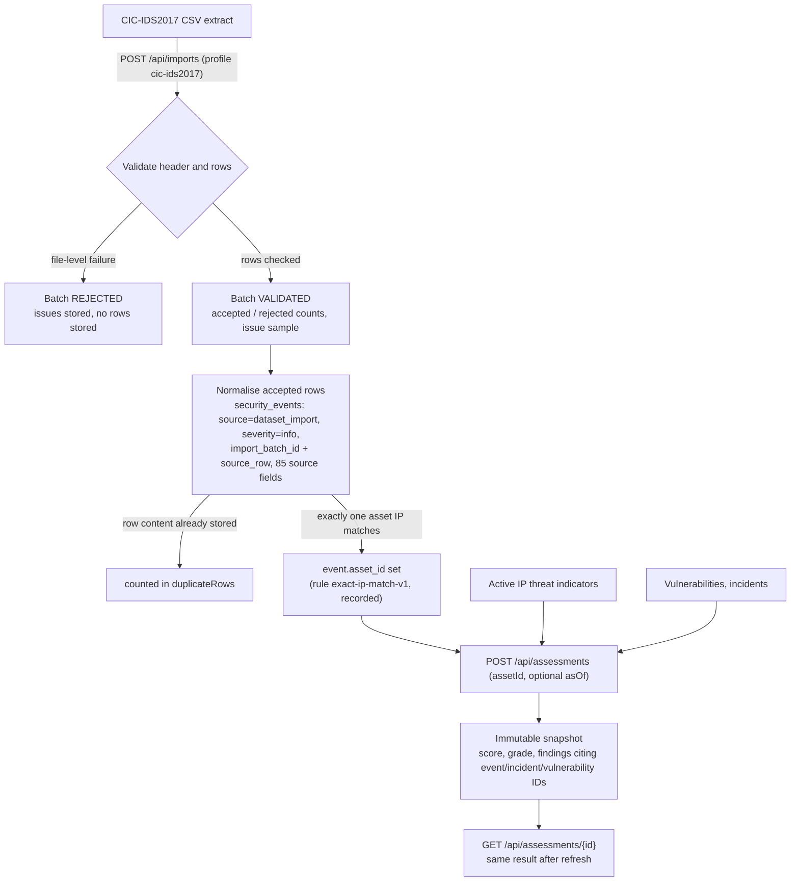
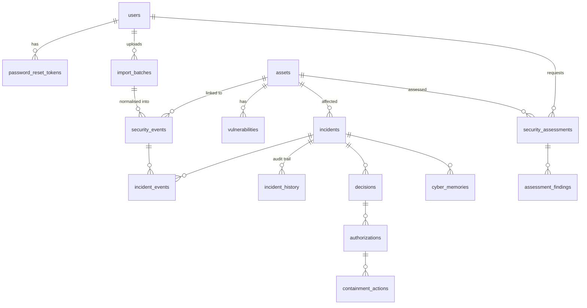

# NETRA: Project Documentation

*Evidence-grounded cybersecurity decision intelligence. Final-year project documentation, reflecting
the repository on branch `feature/rbac-dataset-import` (2026-10-12, including uncommitted work in the
local working tree).*

Statements about behaviour are based on the code and on recorded test runs. Where something is an
assumption, simulated, or not yet verified, this document says so.

---

## 1. Abstract

NETRA is a web platform that turns cybersecurity records into traceable, prioritised and explainable
findings, and supports controlled, human-authorised response decisions. Users upload a supported
public intrusion-detection dataset (CIC-IDS2017). NETRA validates it row by row, rejecting invalid
rows with stated reasons, and stores accepted rows as normalised security events. Each event keeps a
reference to its import batch and source row.

Incidents are correlated, enriched and risk-scored with documented, deterministic rules. A
recommended response passes through an authorisation step with separation of duties, a **simulated**
containment and a verification, and its outcome is recorded as a lesson. A deterministic Security
Assessment engine grades assets from the evidence actually available, and stores each result as an
immutable snapshot whose findings cite the exact vulnerabilities, incidents and events used.

The system is implemented with FastAPI, SQLAlchemy and PostgreSQL on the backend and React with
TypeScript on the frontend. It is covered by 761 passing backend tests and 78 frontend tests in the
latest recorded runs.

## 2. Problem statement

Security teams receive large volumes of events, alerts, asset details, vulnerabilities and threat
indicators. When these are reviewed separately, it is difficult to determine:

- which records are related;
- which risks deserve attention first;
- why a particular response is recommended;
- what was decided, by whom, and with what result.

Tools that output an unexplained score or an unsupported claim do not help an analyst defend a
decision. The problem NETRA addresses: *given the security records and context actually available,
what should be investigated first, why, and what is a sensible next step*, with the reasoning open to
inspection.

## 3. Objectives

1. Ingest a supported public dataset through authenticated upload with schema validation, malformed
   and duplicate handling, and batch provenance.
2. Normalise accepted records into a canonical event representation that keeps original fields and
   a link to the source row.
3. Correlate and enrich only where implemented rules and available evidence support a relationship.
4. Calculate explainable risk scores and asset assessments with reasons, evidence references and
   stated gaps.
5. Recommend proportionate actions and record authorisation, (simulated) containment and
   verification states.
6. Store incident outcomes and lessons in Cyber Memory.
7. Evaluate correctness and traceability with automated tests.

## 4. Scope and limitations

**In scope (implemented):** authenticated CIC-IDS2017 upload and validation; normalisation into
events with provenance; content-aware deduplication; incident lifecycle (correlation, enrichment,
risk, verification, decision, authorisation, simulated containment, verification, Cyber Memory);
deterministic Security Assessment with persisted snapshots; role-based permissions; an API-backed UI
with loading, empty and error states.

**Out of scope or not claimed:**
- real host isolation, firewall or account changes (containment is simulated);
- live SIEM/EDR integrations or live-feed adapters;
- AI/LLM analysis or autonomous learning (Cyber Memory records lessons, but nothing feeds back into
  scoring);
- NETRA's own detection rules over imported dataset flows (dataset labels are not treated as
  detections);
- universal support for arbitrary datasets;
- guaranteed detection or fixed processing times.

Detailed limitations are listed in [section 11](#11-results-and-limitations).

## 5. System architecture and data flow

**Dataset-to-assessment data flow**

**Incident lifecycle** (`IncidentState`): `detected → understood → prioritised → verified →
authorized → contained → learned`. The service functions that drive it are in
`backend/app/services/` (section 6).

## 6. Module descriptions

| Module | Key files | What it does |
|---|---|---|
| **Authentication** | `api/auth.py`, `services/auth.py`, `services/password_reset.py`, `core/permissions.py` | JWT (HS256) login; `GET /api/auth/me`; Argon2 hashing; self-registration off by default; emailed password reset with SHA-256-hashed single-use tokens; rate limits on reset requests. Roles `operator`, `approver`, `admin` map to four permissions. |
| **Dataset import** | `api/imports.py`, `services/dataset_import.py`, `services/dataset_profiles.py` | Streams the multipart upload through a byte cap, hashes it (SHA-256), validates it against a profile and records an `import_batch`. Issues name row, column and rule only. 10 uploads per user per minute. |
| **Normalisation** | `services/dataset_normalization.py`, `CicIds2017Profile.normalize_row` | Turns accepted CIC-IDS2017 rows into `network_flow` events in chunks of 1,000, inside the batch transaction. Content-hash deduplication, exact-IP asset linking, full provenance in `raw_data`. |
| **Event intake** | `api/events.py`, `api/collector.py`, `services/intake.py`, `services/collector.py` | Event list (filters include `source` and `importBatchId`) and detail. Manual/collector submission stores events as `manual` (the `dataset_import` source is reserved). |
| **Correlation and enrichment** | `services/event_correlation.py`, `services/context_enrichment.py` | Links events to an incident within a 30-minute window by shared addresses and attack family. Adds asset, vulnerability and threat-intelligence context. |
| **Risk and prioritisation** | `services/risk_engine.py`, `services/prioritization.py` | Weighted factors: asset criticality 0.25, vulnerability 0.20, anomaly 0.20, detection confidence 0.15, threat intelligence 0.10, attack context 0.10. Each factor carries a rationale. Every calculation is stored as an append-only `risk_evaluations` row in the same transaction; `GET /api/incidents/{id}/risk-evaluations` returns them oldest first (signed-in users; `404` for an unknown incident). Active incidents are ordered by risk score (unscored last), then severity, then asset criticality. |
| **Decision workflow** | `services/decision_workflow.py`, `api/decisions.py`, `api/authorizations.py` | Deterministic recommendation (`ISOLATE_HOST`, `BLOCK_IP`, `INVESTIGATE` or `MONITOR`, by documented thresholds). Request, approve or reject authorisation, with the approver required to differ from the requester. |
| **Controlled response** | `services/controlled_response.py`, `api/containments.py` | **Simulated** containment of an approved action (records `"simulated": true`; changes no external system). Verification of the outcome; Cyber Memory entry with the lesson. |
| **Security Assessment** | `services/assessment_engine.py` (pure), `services/assessment.py`, `api/assessments.py` | `assessment-v2`: nine checks, severity-based deductions from 100, grades A–F. Bounded evidence loading; immutable snapshots; optional `asOf`. 10 runs per user per minute. |
| **Read-only context** | `api/assets.py`, `api/threat_intelligence.py`, `api/dashboard.py`, `services/risk_trend.py`, `api/health.py` | Asset inventory and vulnerabilities, threat indicators, dashboard statistics, `/api/health` and `/api/health/db`. `GET /api/dashboard/risk-trend?range=24h\|7d` (signed-in users) returns 24 hourly or 28 six-hour buckets of average active-incident risk, active/scored incident counts and events by source, reconstructed from stored history without recalculating or writing data. |
| **Data and administration** | `db/init_db.py`, `db/seed_demo.py`, `db/seed_dataset_context.py`, `scripts/netra_users.py`, `scripts/netra_e2e.py`, `scripts/netra_e2e_pytest.py`, `services/dataset_profiler.py` | Schema creation, fictional demo dataset, CIC-IDS2017 demo asset and indicator, guarded user administration, isolated test-database setup guard, guarded pytest launcher, offline dataset profiler. |
| **Frontend** | `frontend/src/pages`, `src/services`, `src/lib`, `src/api/types.ts` | Pages for each module; the service layer adapts API responses; pure helper functions are unit-tested. |

## 7. Database overview

PostgreSQL. 16 application tables plus `alembic_version`. UUID primary keys; `INET` for addresses;
`JSONB` for raw payloads and evidence lists; enums stored as `VARCHAR` with `CHECK` constraints.

| Table | Purpose | Notable constraints |
|---|---|---|
| `users` | Accounts, role, active flag | Unique email |
| `password_reset_tokens` | Hashed single-use reset tokens | FK `users` (cascade) |
| `assets` | Inventory: key, IP, criticality, exposure, status | Unique `asset_key` |
| `vulnerabilities` | Per-asset CVE/CVSS/severity/status | FK `assets` |
| `threat_indicators` | IP/domain/URL/hash indicators, source, severity, active flag | — |
| `security_events` | Normalised events; `raw_data` JSONB; `import_batch_id`, `source_row` | Unique `event_uid`; batch and row are both set or both null; unique (batch, row) where imported; port ranges |
| `import_batches` | Upload record: profile/version, SHA-256, counts, issue sample, `events_created`, `duplicate_rows` | Partial unique index (profile, version, hash) where validated; accepted + rejected = total; created + duplicates ≤ accepted |
| `incidents`, `incident_events`, `incident_history` | Incident, event links, audit trail of state changes | State and action enums |
| `decisions`, `authorizations`, `containment_actions`, `cyber_memories` | Response workflow records | FKs to incident, decision and authorisation |
| `security_assessments`, `assessment_findings` | Immutable assessment snapshots and per-check findings | Score 0–100, grade A–F, unique (assessment, check) |
| `risk_evaluations` | Append-only history of incident risk calculations: score, level, methodology version, factors, missing evidence, matched indicators, trigger, actor | Score and previous score 0–100; level LOW/MEDIUM/HIGH/CRITICAL; trigger initial/reevaluation; deleted only with its incident; index (incident, created_at) |

**Migrations** (`backend/migrations/versions`):

| Revision | Adds |
|---|---|
| `0001_add_users_table` | `users` |
| `0002_add_password_reset_tokens` | `password_reset_tokens` |
| `0003_add_security_assessments` | `security_assessments`, `assessment_findings` |
| `0004_add_import_batches` | `import_batches` |
| `0005_dataset_event_provenance` | `security_events.import_batch_id` and `source_row`; `import_batches.events_created` and `duplicate_rows`; `dataset_import` source value |
| `0006_add_risk_evaluations` | `risk_evaluations` (fails clearly if `incidents` is missing; skips a table already created by `init_db`) |

The core operational tables are created by `app.db.init_db`; migrations `0002`–`0006` are guarded
for tables that already exist. On the local development database, 0002–0005 were applied with a
verified `pg_dump` backup before each step, and pre-existing row counts were unchanged; 0006 was
applied to the local development and E2E databases on 2026-10-25, each after a verified `pg_dump`
backup and a read-only schema check. Production migration state has **not** been verified for this
version, and 0006 has not been applied there.

## 8. Security considerations

- **Authentication:** JWT bearer tokens (60-minute default) and Argon2 password hashes. Role and
  active status are re-read on every request, so deactivation and role changes take effect
  immediately.
- **Authorisation:** permission checks on every write route. Approval requires
  `resolve_authorization` (approver/admin) and a different person from the requester. Self-registration
  is off by default and never grants more than `operator`.
- **Untrusted uploads:**
  - byte, row and line-length caps; strict decoding; binary (NUL) content rejected; only `.csv`
    files accepted;
  - validation messages never echo cell contents; filenames are sanitised;
  - per-user rate limits on uploads, assessments and collector submissions.
- **Provenance integrity:**
  - imported events always name their batch and row (enforced by a database `CHECK`);
  - the `dataset_import` source cannot be claimed through manual ingest;
  - the batch and its events commit together or not at all;
  - migration 0005's downgrade refuses to drop provenance while imported events exist.
- **No live response:** containment is simulated and changes no external system.
- **Secrets:**
  - `DATABASE_URL` and `JWT_SECRET_KEY` live in gitignored `.env` files;
  - settings use `SecretStr`, and the admin and seed scripts print only `host:port/database`;
  - the test database uses a separate JWT secret.
- **Operational safety:**
  - seed and admin scripts are dry run by default or require `--confirm-target`, and refuse
    ambiguous targets;
  - backend tests run only against the isolated `netra_e2e` database, through
    `scripts/netra_e2e_pytest.py`. Before pytest starts, it checks the target statically (local host,
    database `netra_e2e`, port 5432, a separate JWT secret). It builds a child environment from
    `.env.e2e` only, runs that child in an empty folder outside the repository, and proves from the
    Windows listener table and the connected server process that the server is a local `postgres.exe`.
- **CORS:** explicit allow-list (`CORS_ORIGINS`) for the local dev server origins.

## 9. Testing and validation evidence

| Suite | Scope | Latest recorded result |
|---|---|---|
| Backend (pytest, 31 modules) | Models and constraints, migrations (including 0005 round-trip and revision-ID length), auth and registration policy, role permissions, import API and CIC profile, normalisation and provenance, deduplication, rollback on failure, asset linking, assessment engine (v1/v2) and API, risk, prioritisation, workflow, containment, Cyber Memory, collector, seeds and admin CLI | **761 passed, 1 skipped**, 2026-10-12, isolated `netra_e2e` database, run with `python -I -B scripts\netra_e2e_pytest.py run -q`. The skip needs the full CIC-IDS2017 files via `NETRA_CIC_DATASET_DIR`. |
| Test launcher self-test | `python -I -B scripts\netra_e2e_pytest.py selftest`: every guard checked against synthetic configurations, offline | **92 passed, 0 failed** |
| Frontend (node:test, 9 files) | Dataset-import helpers (outcome, stored rows, provenance), assessment `asOf` helper, HTTP client, authorisation access, login and register errors, incident verification, command-center presentation, landing content | **78/78 passed** |
| Type check / lint / build | `tsc -p tsconfig.app.json --noEmit`, `oxlint`, `vite build` | Pass; 5 pre-existing lint warnings in untouched UI files |

**Traceability tests**:
- `test_dataset_normalization.py::test_imported_rows_trace_into_assessment_findings`
- `test_seed_dataset_context.py::test_imported_rows_reach_findings_through_the_indicator_not_the_label`

Both upload CIC rows, assess with a historical `asOf`, and check that every cited event ID maps back
to its batch and source row, including when the stored snapshot is fetched again. The second test
shows that rows labelled DDoS and BENIGN are cited alike when their address matches an indicator,
and a non-matching row is not.

**Manual verification** (reported by the project team): on the local development stack, the flow
dataset import → security events → evidence correlation → security assessment → saved assessment
was exercised in the browser.

## 10. Results

- A CIC-IDS2017 extract can be uploaded, validated and summarised. The summary shows total,
  accepted, rejected, events stored and duplicates, with per-row issue explanations.
- Every stored event shows its source record (file row and import batch), and each batch links to
  the events it stored.
- Security Assessment produces graded, evidence-cited snapshots. With a historical event window,
  imported flows appear in findings only where an implemented rule supports it. Snapshots persist
  and reload unchanged.
- The incident workflow enforces separation of duties and records each state change in an audit
  trail. Containment is simulated.

## 11. Results and limitations

- **No independent detection** over imported flows: imported rows are `info`; labels are ground
  truth only.
- **Asset linking** happens only at import time: events uploaded before a matching asset existed
  stay unlinked.
- **No create API** for assets or threat indicators; demonstration context comes from guarded seed
  modules (`seed_demo`, `seed_dataset_context`).
- **CIC-IDS2017 timestamp** interpretation (12-hour clock, UTC−03:00) is an unverified assumption,
  recorded on every event.
- **`asOf`** bounds events only; vulnerabilities, incidents and indicators are evaluated in their
  current state.
- **Large files:** uploads are processed in the request (25 MiB / 100,000 rows by default), with no
  background jobs or progress reporting.
- **Evaluation:** no precision/recall, confusion-matrix or throughput measurements yet (PDF §10).
- **Testing tooling:** the guarded test launcher (`scripts/netra_e2e_pytest.py`) supports Windows
  with a native local PostgreSQL only; Docker/WSL servers are refused by design. There is no CI.
- **Deployment:** production deployment and migration parity are unverified for this version.

## 12. Future enhancements

1. Documented detection rules over normalised flows, evaluated against dataset labels with
   precision, recall, F1 and confusion matrices on held-out splits.
2. Background, chunked processing for full-size dataset files, with progress and measured
   throughput.
3. A second dataset profile (UNSW-NB15) through the same profile interface.
4. Asset and threat-indicator management APIs with audit trails, and re-linking of earlier events
   under a recorded rule.
5. A versioned, verified timestamp interpretation for CIC-IDS2017.
6. Continuous integration that runs the guarded backend suite and the frontend checks.
7. Verified production deployment and migration parity, and live-feed adapters behind the same
   ingestion boundary.
